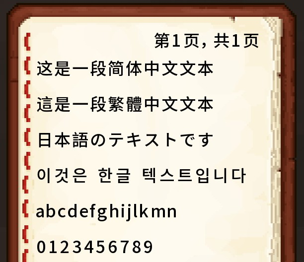

# Minecraft 思源黑体资源包

用[思源黑体](https://github.com/adobe-fonts/source-han-sans)替换 Minecraft 默认字体，无需额外安装模组。适配 26.1。



## 安装

前往 [release](https://github.com/BearBin1215/mc-siyuanhei/releases) 下载 `SiyuanHei-SC-MC26.1-v<version>.zip`，放入 `.minecraft/resourcepacks/` 后启用即可。

资源包使用位图图集：文字清晰、平滑，小字号下笔画更实。包约 21 MiB，图集常驻约 211 MiB 内存。

## 排版说明

- 汉字、假名、韩文：36×36 单元，9px 行高，优先用 33px 字号采样；放不下的字形回退到较小字号。汉字步进 9px。
- 拉丁字母与符号：36×48 单元，12px 行高，在原字体字宽基础上收紧间距，保留完整笔画；数字保持 6px 等宽步进。
- 常用全角标点：36×40 单元，10px 行高，步进 6px；开括号靠近后面的文字，闭括号靠近前面的文字。其他全角标点沿用汉字样式。

## 构建

```bash
pip install -r requirements.txt
python tools/build_bitmap_pack.py
```

脚本会校验资源包元数据与源字体，把生成的图集连同 `bitmap/` 下的元数据、图标打包到 `dist/`。zip 固定了条目顺序和时间戳，同一份输入得到同一份文件，重新构建不会带来无意义的二进制改动。

字体文件已随仓库提供；需要从官方 OTF 重新生成时运行 `python tools/make_font.py <官方 Medium OTF>`，脚本把结果写入 `assets/minecraft/font/siyuan_hei_sc.ttf`。

## 代码检查

```bash
pip install -r requirements-dev.txt
python -m ruff check tools/
python -m ruff format --check tools/
```

## 目录结构

```text
requirements.txt                    # 构建依赖
requirements-dev.txt                # 静态检查依赖
ruff.toml                           # 静态检查配置
preview.jpg                         # 游戏内预览图
bitmap/pack.mcmeta / pack.png       # 资源包元数据与图标
assets/minecraft/font/...           # 位图采样用的源字体
tools/build_common.py               # 版本号、校验与打包的公共实现
tools/make_font.py                  # 官方 CFF OTF → TrueType TTF
tools/build_bitmap_pack.py          # 位图版图集生成与构建
dist/                               # 本地构建产物，不入库，随 Release 与 Modrinth 分发
```

## 许可

- 基于思源黑体 2.005R Medium 转换，转换后字体内部名为 `Siyuan Hei SC Medium`，非官方发行版。
- 字体按 SIL OFL 1.1 分发，见 [LICENSE-OFL.txt](LICENSE-OFL.txt)；资源包结构与构建脚本按 MIT 分发，见 [LICENSE](LICENSE)。
- 字体设计版权归 Adobe；本项目与 Mojang Studios、Adobe 无关联。
